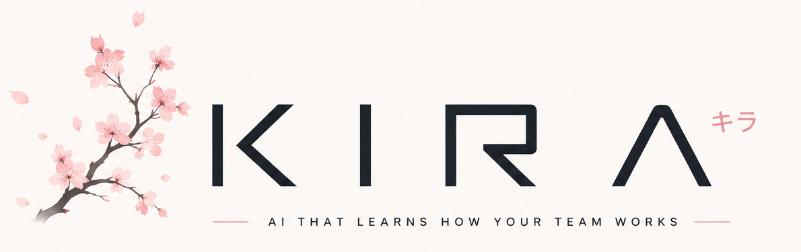
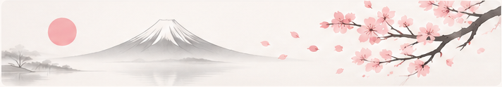
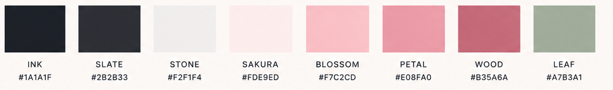

<p align="center">
  <picture>
    <source media="(prefers-color-scheme: dark)" srcset="assets/kira-lockup-dark.png">
    
  </picture>
</p>

<p align="center"><em>Inteligência que entende. Contexto que transforma.</em></p>

<p align="center">
  
  
  
</p>

---

A Kira é uma colega de IA para times de criação e de recrutamento. Ela analisa artes e
candidatos, lembra como **os seus** revisores julgam o trabalho e fica mais alinhada com eles a
cada revisão.

Não é um ATS genérico, nem uma ferramenta de "dê uma nota para o meu design". O produto é o
**ciclo de memória**:

```
  a Kira propõe uma avaliação  →  uma pessoa corrige
            ↑                               ↓
  a próxima avaliação parte daí  ←  a correção vira conhecimento do time
```

## O que ela faz

**Criação** — avalia artes, campanhas e copy por critério (composição, tipografia, cor,
consistência de marca), mede o que dá para medir na imagem e mostra quais memórias usou em cada
nota. A pessoa corrige critério a critério, e a correção fica.

**Recrutamento** — lê CVs e portfólios, pontua candidatos para uma vaga e explica o ranking.
Características pessoais protegidas são removidas dos documentos antes de qualquer modelo
vê-los, e toda afirmação sobre um candidato vem com o trecho do documento que a sustenta.

**Conhecimento** — cada marca atendida tem a própria memória. Regras que o time já tem entram
coladas ou extraídas de um brand book, e o material de um cliente nunca aparece como referência
para outro.

**Conversa** — a Kira inteira pode ser usada de dentro do Claude, por um servidor MCP.

## Regras da casa

1. **Nada roda sozinho.** Toda análise começa com alguém pedindo, a menos que o time ligue a
   automação.
2. **A IA propõe, as pessoas decidem.** Nenhum registro escrito pela IA vale sozinho.
3. **A Kira admite quando erra.** Ela mede o próprio viés contra o de cada revisor e mostra.

<p align="center">
  
</p>

## Como é feita

<p>
  
  
  
  
  
  
  
  
  
</p>

- **Memória com RAG** sobre embeddings no pgvector, ranqueada e com origem rastreável.
- **Multi-tenant** com row-level security no PostgreSQL: cada agência isolada pelo banco.
- **Filas** com pg-boss para as análises, e armazenamento compatível com S3.
- **246 testes de integração** contra um Postgres real, incluindo um cliente MCP de verdade.
- **Acessibilidade medida:** todo par de texto da interface passa WCAG AA, calculado e não estimado.

## Design

Linguagem *Shoji + Workbench*: superfícies separadas por linha fina, sem sombra, raio de 2px;
o trabalho em linhas com uma faixa de severidade que deixa achar o que precisa de atenção antes
de ler. Jost nos títulos, Inter na interface.

<p align="center">
  
</p>

---

<p align="center"><sub>O código é privado. Para conhecer o produto ou ver uma demonstração, fale com a equipe.</sub></p>
